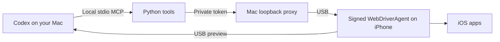

# EU iPhone Use by Balta Tech

**Control your iPhone from Codex over USB. No product tracking. Authenticated local control. Faster workflows with batching and connection reuse.**

EU iPhone Use connects an AI assistant to your real iPhone through a local MCP server. Open apps, read screens, tap controls, enter text, and verify results while watching a live preview on your Mac. It uses Apple's developer testing tools, your own signing identity, and a USB cable. No jailbreak, iPhone Mirroring, or separately running Appium server is required.

Built by [Balta Tech](https://balta-tech.com/en/) for European privacy requirements, this MIT-licensed derivative of [zhongerxin/iPhone-use](https://github.com/zhongerxin/iPhone-use) removes product telemetry and adds authenticated USB control, private authentication handoff, and performance improvements. Original copyright and licence notices are preserved. [Changes and attribution](UPSTREAM.md).

## No tracking and controlled access

- **Zero product telemetry.** No usage analytics, installation tracking ID, advertising SDK, or automatic crash-report upload. The collection code and configuration are removed.
- **USB device control.** The phone's command and preview services bind to `127.0.0.1`. No Balta Tech cloud relay or remote administration service is involved.
- **Authenticated local proxy.** The Mac listener binds to loopback, requires a private random token, and rejects browser Origin headers.
- **Local app discovery.** Installed apps and a bundled offline reference resolve app names without online App Store searches.
- **Private handoff.** Pause observation for passwords, Apple sign-in, verification codes, Face ID, and Touch ID. Handle authentication directly on your device.
- **Private local state.** Preview frames stay in memory. Temporary observation images use private files and are removed on orderly session shutdown; interrupted sessions can leave local files for cleanup.

These defaults support GDPR data minimisation and data protection by design. Screens and text shared with the assistant are processed by your chosen AI provider under your account's terms and settings. Business deployments must choose suitable provider, access, retention, and data-residency arrangements. [Full data flow](PRIVACY.md) · [Security boundaries](SECURITY.md).

## Faster everyday workflows

Version 0.6.1 reduces repeated work across the model, MCP server, and phone:

| Improvement | What changes |
| --- | --- |
| Known-step batches | Send up to 20 known operations in one tool call and request one final observation. Seven taps plus a final read can use one call instead of eight. |
| Persistent USB connection | Reuse one serial authenticated HTTP connection instead of reopening the USB connection for each request. |
| Preview geometry cache | Reuse geometry for up to 10 seconds while fresh frame dimensions agree; refresh after rotation or stale metadata. |
| Adaptive preview | Auto requests 2 FPS at idle and 8 FPS around activity. Eco stays at 2 FPS; Fast requests 8 FPS. |
| Compact results | Return the useful outcome and final screen without repeating intermediate target details. |
| Warm runner and ownership | Release phone control between turns while keeping the runner available. Idle ownership expires after 60 seconds. |

**Planning estimate: save 21 seconds of orchestration waiting on a known seven-tap workflow**, assuming three seconds per model/tool handoff and seven handoffs avoided. This is a calculated workflow estimate, separate from phone execution time. The recorded physical Calculator baseline is **5.2 seconds for seven taps and a final tree read** on version 0.4.0. [Performance details and assumptions](PERFORMANCE.md).

## How it works



The assistant reads accessibility text or a screenshot, chooses an action, and checks the resulting screen. Known sequences can run as a batch. Unfamiliar screens require a fresh observation. Failed writes are never automatically replayed.

## Requirements

- A Mac with full Xcode, its initial components, and support for your iPhone's iOS version.
- Codex desktop and Codex CLI with local plugin/MCP support.
- Python 3.9+; Node.js 20.19+, 22.12+, or 24+; npm 10+.
- Your own iPhone, a USB data cable, and your own Apple account for signing.

## Install

Clone the repository and register the plugin. While the repository is private, your GitHub account needs access.

```sh
mkdir -p ~/dev/projects
cd ~/dev/projects
git clone https://github.com/bal-r/eu-iphone-use.git
cd eu-iphone-use
sh scripts/install.sh
```

The installer stages the plugin and registers the `balta_iphone_use` local MCP server through a stable launcher. Reconnect Codex or open a new chat, then enable **Balta Tech iPhone Use** if prompted. The installation does not need your Apple password.

1. Open **Xcode → Settings → Accounts** and sign in to your own Apple account in Apple's UI.
2. Connect and unlock your iPhone. Accept **Trust This Computer** and let **Xcode → Window → Devices and Simulators** prepare it.
3. Enable **Settings → Privacy & Security → Developer Mode** on the phone when requested. Complete its restart and confirmation. Enable **Settings → Developer → Enable UI Automation** if requested. Trust only your own development identity if iOS asks.
4. Ask Codex:

   ```text
   Use iphone-use-setup to configure my USB-connected iPhone.
   Use the Balta Tech checkout, my own Apple team, and a unique bundle ID.
   Fetch the pinned WDA, apply and verify its loopback patch, then build and start it.
   Wait for pua_ready to return ready=true.
   Open Calculator and verify 12 × 34 = 408, then report the result.
   I will handle Apple login, trust prompts, unlock, and authentication directly.
   ```

5. Start with a specific task, such as: “Open my app, inspect the settings page, and report what you see.”
6. Finish with `pua_setup(action="stop")`, close the preview, and disconnect USB. Closing a chat or releasing ownership can leave the USB runner active.

Apple's free Personal Team supports personal-device testing with seven-day provisioning. Rebuild and reinstall the runner when that provisioning expires. [Apple account guidance](https://developer.apple.com/help/account/basics/about-your-developer-account).

## MCP setup and session controls

The recommended installer includes both operating skills and the MCP registration. Check the registration with:

```sh
codex mcp list
codex mcp get balta_iphone_use --json
```

The server uses local **stdio**; no public MCP URL or externally exposed port is needed. For the supported MCP configuration format, see [OpenAI's MCP documentation](https://learn.chatgpt.com/docs/extend/mcp).

- `pua_setup(action="status")` reports service state, running version, and installed-version mismatch.
- `pua_ready(screenshot=false)` checks the connection and returns a fresh observation when ready.
- `pua_device(action="release")` releases conversation ownership while keeping the USB runner warm.
- `pua_setup(action="stop")` ends the owned runner job.
- `scripts/phone.py --session` provides a persistent CLI fallback.

The preview provides Pause/Resume, frame age, Auto/Eco/Fast pacing, and Point mode for sharing a selected target without tapping the phone. Host support for native preview and lifecycle hooks varies. [Controls and result contracts](USABILITY.md).

## Validation and development

Recorded on 3 November 2026 for version 0.6.1: **514 Python tests, 65 widget tests, and 6 proxy/transport tests passed**, together with UI build, package validation, and real stdio startup/catalog/ping checks. The original 0.4.0 physical session verified Calculator, rejection of unauthenticated Mac access, and refusal of Wi-Fi connections to the phone's command and preview ports. Full 0.6.1 physical performance and takeover acceptance remains pending. [Detailed evidence](TESTING.md).

```sh
npm ci --prefix ui --ignore-scripts --no-audit --no-fund
npm run build --prefix ui
npm test --prefix ui
node --test tooling/tests/*.test.mjs
sh scripts/check.sh
```

The phone runner is pinned and its approved loopback patch is verified before managed builds and startup. Runtime dependencies use the committed lockfile and `npm ci --ignore-scripts`. Review dependency and runner changes deliberately.

If this project helps your work, [star EU iPhone Use on GitHub](https://github.com/bal-r/eu-iphone-use) and share a reproducible use case or issue.
